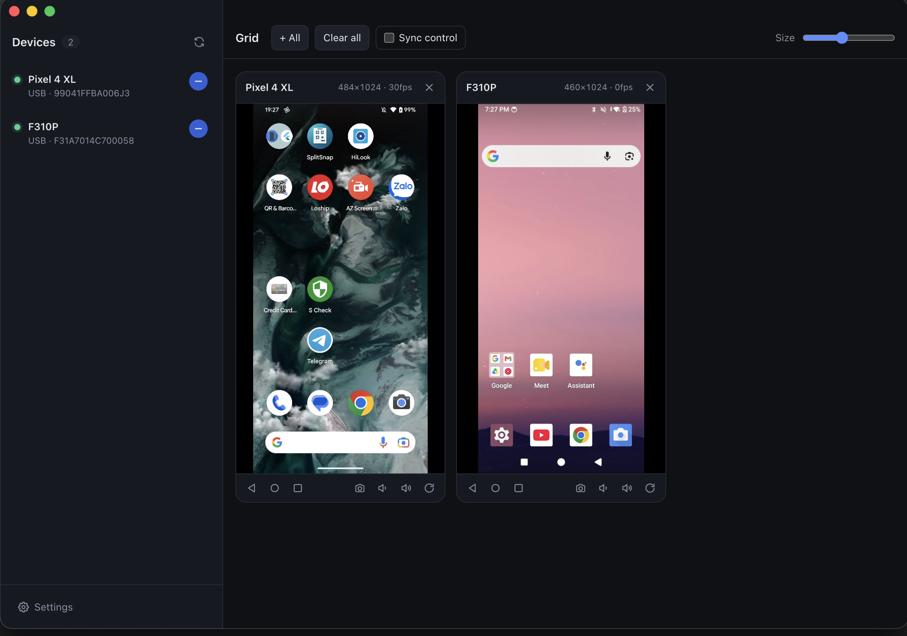

# Mob Hub

> This is an unofficial project. It is not affiliated with or endorsed by Genymobile or the scrcpy project.

An Electron wrapper for [scrcpy](https://github.com/Genymobile/scrcpy) on macOS:

- **Device list**: shows the connected devices (USB and Wi-Fi). The list updates every 1.5 seconds.
- **Click a device** to open a native scrcpy window. The app arranges the windows in a grid to the right of the app.
- **In-app grid**: click `+` next to a device to see and control a phone screen in the app window. You can show many devices at the same time.
- **Sync control**: when you use one device, all devices in the grid do the same action (tap, swipe, key input, Home/Back).
- **Screenshot**: click the camera button on a grid tile to save a full-resolution PNG from the device (through `adb screencap`). The app saves it to the Desktop, or to the folder set in Settings, and copies it to the clipboard. With Sync control on, the app takes a screenshot of each device in the grid. Screens that an app protects (for example, banking apps or DRM video) come out black.



## Requirements

```bash
brew install scrcpy android-platform-tools   # scrcpy + adb
```

Node.js 20.19 or later (or 22.12 or later).

## Run

```bash
npm install        # postinstall downloads scrcpy-server v5.0.1 into resources/
npm run dev        # dev mode with hot reload
npm run dist:mac   # build .dmg files (arm64 and x64) into dist/
```

The `.dmg` is not signed or notarized. On first launch, macOS blocks it. To open it, right-click the app in Applications and select **Open**, or run `xattr -dr com.apple.quarantine "/Applications/Mob Hub.app"`.

When you open the app for the first time, if it cannot find adb or scrcpy, it opens Settings. Set the paths there.

## How it works

| | Mode A: scrcpy window | Mode B: in-app grid |
|---|---|---|
| Start | Click the device name | `+` button next to the device |
| Runs | The installed `scrcpy` binary (`-s <serial> --window-x/y/height`) | Only `scrcpy-server` v5.0.1, pushed to the device through adb |
| Video | scrcpy SDL window | H.264 → IPC → WebCodecs → `<canvas>` |
| Control | All scrcpy controls | Tap/swipe, scroll, key input, right-click = Back, nav buttons, screenshot |

Mode B uses the [Tango / ya-webadb](https://github.com/yume-chan/ya-webadb) libraries. Refer to [Libraries](#libraries).

## Libraries

### Runtime

| Library | License | Used for |
|---|---|---|
| [scrcpy-server](https://github.com/Genymobile/scrcpy) | Apache-2.0 | Server that runs on the device. It captures the screen and receives the control messages. |
| [`@yume-chan/adb`](https://github.com/yume-chan/ya-webadb) | MIT | adb protocol: connect to a device, push files, run commands. |
| [`@yume-chan/adb-server-node-tcp`](https://github.com/yume-chan/ya-webadb) | MIT | Connect to the local adb server through TCP. |
| [`@yume-chan/adb-scrcpy`](https://github.com/yume-chan/ya-webadb) | MIT | Push and start scrcpy-server through adb. |
| [`@yume-chan/scrcpy`](https://github.com/yume-chan/ya-webadb) | MIT | scrcpy protocol: server options, video packets, control messages (touch, key, scroll). |
| [`@yume-chan/scrcpy-decoder-webcodecs`](https://github.com/yume-chan/ya-webadb) | MIT | Decode H.264 with WebCodecs and draw the frames on a `<canvas>` (WebGL or bitmap). |
| [`@yume-chan/stream-extra`](https://github.com/yume-chan/ya-webadb) | MIT | Web stream types that the other `@yume-chan` packages use. |
| [React](https://react.dev) | MIT | Renderer UI. |

The `@yume-chan` packages are at `3.0.0-beta.3`. Only this beta version supports scrcpy-server versions later than 3.3.3.

### Development and build

| Library | License | Used for |
|---|---|---|
| [Electron](https://www.electronjs.org) | MIT | Desktop app shell. |
| [electron-vite](https://electron-vite.org) | MIT | Dev server and build for the main, preload, and renderer processes. |
| [Vite](https://vite.dev) + [`@vitejs/plugin-react`](https://github.com/vitejs/vite-plugin-react) | MIT | Renderer bundler with React hot reload. |
| [electron-builder](https://www.electron.build) | MIT | Package the app as a `.dmg` file. |
| [TypeScript](https://www.typescriptlang.org) | Apache-2.0 | Type checking. |

### External tools (not bundled)

| Tool | Used for |
|---|---|
| [scrcpy](https://github.com/Genymobile/scrcpy) | Mode A: native scrcpy windows. |
| [adb](https://developer.android.com/tools/adb) (Android platform-tools) | Device list and the adb server. |

## Structure

```
src/main/      index.ts (window + IPC), adb.ts (device list), external.ts (mode A), grid.ts (mode B),
               screenshot.ts, settings.ts, tools.ts (find adb/scrcpy)
src/preload/   IPC bridge → window.api
src/renderer/  React UI: App.tsx, GridTile.tsx (decoder + input), gridBus.ts (video packet routing),
               SettingsDialog.tsx, icons.tsx
src/shared/    shared data types, scrcpy-server.json (server version + SHA-256)
scripts/       fetch-server.mjs (download scrcpy-server), make-icon.py (app icon)
build/         app icon for electron-builder
third_party/   licenses of bundled third-party software
```

## Notes

- **The server version must match the library.** The server version and its SHA-256 are in `src/shared/scrcpy-server.json`. The app and `scripts/fetch-server.mjs` read them from this file and reject a file with a different hash. The server protocol must be one that `@yume-chan/scrcpy` supports (`ScrcpyOptionsLatest`, 4.1 in `3.0.0-beta.3`). Server 5.0.1 uses the same protocol as 4.1. When you change the server version, update the two values in the JSON file.
- **macOS does not let an app embed the window of a different process.** Thus, Mode A only arranges the windows next to each other.
- **One device can run in the two modes at the same time.** This uses two times the bandwidth.
- **Text input in the grid:** the grid gets text from a hidden text field, so macOS input methods (for example, Vietnamese Telex or VNI) work. The app sends ASCII text with `injectText`. scrcpy-server cannot type other characters (for example, Vietnamese diacritics or emoji) as key events, so the app sends them through the device clipboard and a paste action. When the pastes stop, the app puts back the text that you last copied on the device. It can do this only if you copied that text while the device was in the grid. On Android 6 and earlier, the paste action is not available, so these characters are not typed.
- **Keyboard shortcuts in the grid:** the app does not send Cmd to the device, because Android opens the Assistant when Meta is pressed alone. Cmd+A, Cmd+C, Cmd+X, Cmd+Z and Cmd+Y go to the device as Ctrl+A, Ctrl+C, Ctrl+X, Ctrl+Z and Ctrl+Y. Cmd+V pastes the Mac clipboard text into the device. Other Cmd shortcuts (for example, Cmd+Q, Cmd+W, Cmd+Tab) stay on the Mac.
- **Press and hold:** the app turns off the macOS accent popup that appears when you hold a key, so that a held key repeats on the device.

## License

This project uses the [MIT License](LICENSE).

The packaged app contains `scrcpy-server` from [scrcpy](https://github.com/Genymobile/scrcpy) (Apache-2.0). Refer to [third_party/README.md](third_party/README.md).
